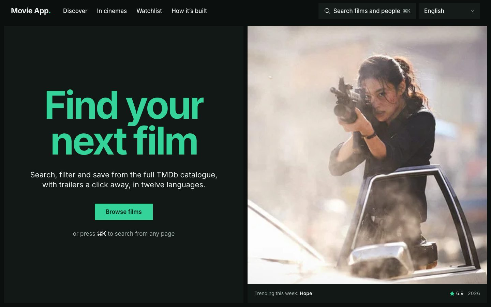

# Movie App

[](https://github.com/Luigi-DV/vue-movies-api/actions/workflows/build.yml)

**Live:** [movieapp.ldvloper.com](https://movieapp.ldvloper.com) · **Case study:** [movieapp.ldvloper.com/about](https://movieapp.ldvloper.com/about)

A Vue 3 single-page app for browsing the full [TMDb](https://www.themoviedb.org) catalogue: search from anywhere with ⌘K, filter by genre, year and rating, watch trailers in place and keep a watchlist without an account, in twelve languages.



## What it shows

| | |
| --- | --- |
| **Search palette** | ⌘K, Ctrl K or `/` on any page. Debounced multi-search across films and people, full keyboard support, recent picks remembered. |
| **URL as state** | Genre, year, sort order and page live in the query string, so every view can be shared, bookmarked and undone with the back button. |
| **Film pages** | One request per page with `append_to_response` (credits, videos, recommendations, certifications). The best official trailer plays in an accessible dialog. |
| **Watchlist** | Pinia store persisted to `localStorage` with VueUse, kept in step across tabs. Clearing offers undo instead of a confirmation. |
| **People** | Biography, “known for” and a full filmography merged across acting and crew credits. |
| **Languages** | Titles, overviews, posters and trailers follow the chosen content language, right to left included. |

## Architecture

```
Browser ──GET /api/tmdb/movie/603──▶ Vercel edge ──rewrite──▶ api/tmdb.js ──+api_key──▶ api.themoviedb.org
                                     (s-maxage=3600)
```

- **The API key never reaches the browser.** The client only knows `/api/tmdb/*`. In production a Vercel function (`api/tmdb.js`) adds the key and sets `Cache-Control: s-maxage=3600, stale-while-revalidate=86400`; in development the Vite proxy does the same.
- **Stale answers never win.** `useTmdb` is a small reactive request composable: it re-runs when its inputs change and aborts the request in flight, and successful responses stay in memory for five minutes.
- **Accessible by default.** Headless UI dialogs and combobox, a skip link, visible focus, live regions for results and `prefers-reduced-motion` support for every animation.
- **Design system in tokens.** Tailwind CSS 4 `@theme` holds one typeface, one accent, five type sizes and light and dark palettes; surfaces are separated by tone, not lines or shadows.

```
src/
  api/          TMDb client (proxy URL, errors, in-memory cache, image helpers)
  composables/  useTmdb, useRouteQuery, useCatalogue, usePageTitle
  stores/       preferences, watchlist, search (Pinia, setup syntax)
  components/   layout, home sections, movie tiles, dialogs, UI states
  views/        home, discover, lists, film, person, watchlist, case study, 404
api/tmdb.js     Vercel serverless proxy
e2e/            Playwright tests with an offline TMDb mock
```

## Stack

Vue 3.5 (Composition API, `<script setup>`) · Pinia 3 · Vue Router 4 · Vite 7 · Tailwind CSS 4 · VueUse · Headless UI · Vitest · Playwright · ESLint 9 · GitHub Actions · Vercel

## Getting started

Requires Node 22.

```sh
npm install
cp .env.example .env   # add your TMDb v3 API key
npm run dev
```

No key? Set `TMDB_PROXY_TARGET=https://movieapp.ldvloper.com` in `.env` and the dev server forwards `/api/tmdb` to the deployed proxy instead.

For production, set `TMDB_API_KEY` in the Vercel project’s environment variables.

## Scripts

| Command | |
| --- | --- |
| `npm run dev` | Dev server with the TMDb proxy |
| `npm run build` | Production build |
| `npm test` | Unit tests (Vitest): API client, composables, stores, components, serverless handler |
| `npm run test:e2e` | Browser tests (Playwright, desktop and mobile) against a mocked TMDb |
| `npm run lint` | ESLint |

CI runs lint, unit tests, the build and the browser tests on every push to `master`.

## Credits

Film data and images from [TMDb](https://www.themoviedb.org). This product uses the TMDB API but is not endorsed or certified by TMDB.

Built by [Luigelo Davila](https://github.com/Luigi-DV).
